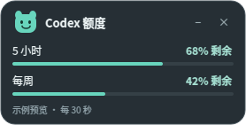

# Codex Usage Panel · 额度悬浮窗

一个独立于 Codex 客户端的桌面额度小窗。显示账号剩余额度、重置时间，每 30 秒更新，支持拖动、置顶和收起。也提供 MCP Apps 卡片和本机浏览器侧栏面板。



不修改客户端安装包，不增加开机自启动。源码独立保存，客户端升级不会覆盖；官方接口变化仍可能需要更新插件。

## 安装

需要已登录的 Codex、本机 Python 3.7+。桌面悬浮窗还需要 PyQt5；已在 Linux X11 上验证，其他平台的桌面置顶行为尚未验证。

```sh
git clone https://github.com/Mars-cb/codex-usage.git
cd codex-usage
python3 -m pip install -r plugins/codex-usage-panel/requirements.txt
codex plugin marketplace add .
codex plugin add codex-usage-panel@local-usage-tools
```

已通过系统包安装 PyQt5 时可以跳过 pip 安装。若 `codex` 不在 PATH，使用本机 Codex 可执行文件的完整路径。新开聊天后使用插件并输入“打开额度悬浮窗”；客户端可能需要重启后才会发现新增市场。

也可以从 [Releases](https://github.com/Mars-cb/codex-usage/releases) 下载 `codex-usage-v*.zip`，解压后在该目录执行市场注册和安装命令。

## 使用

直接运行：

```sh
./start-floating.sh
```

- 左键拖动：放到输入框附近或桌面任意位置。
- 双击或点 `−` / `+`：收起、展开。
- 悬停：查看重置时间。
- 右键：立即刷新或退出。
- 点 `×`：关闭窗口，停止它的额度读取进程。
- 重复启动：复用已有窗口，避免重复创建。

```sh
./start-floating.sh --status
./start-floating.sh --quit
```

小窗是插件自己的桌面窗口，不修改 ChatGPT Pets。它不能嵌入“帮我批准”旁的客户端原生工具栏；可以手动拖到附近。位置和展开状态写入 `PLUGIN_DATA`，直接启动时写入插件目录的 `.local-state/position.json`。

仅需侧栏面板时运行：

```sh
python3 plugins/codex-usage-panel/server.py --dashboard
```

打开终端输出的本机地址，或将其放到客户端浏览器侧栏。侧栏只依赖 Python 标准库。MCP Apps 内嵌卡片和宿主画中画仍需在支持它们的客户端中验证。

## 数据来源

插件调用官方 `codex app-server` 的 `account/rateLimits/read`，复用本机已有登录状态。不会发起模型推理、购买额度或兑换重置。

账号额度在所有聊天之间共享，并非当前聊天的上下文余量。如果客户端当前聊天使用不同账号、工作区或远程主机，数据可能不同。剩余比例为 `clamp(100 - usedPercent, 0, 100)`；未知数据显示未知，失败刷新清空旧值。重置时间到达后等待服务端返回新值，不自行假设恢复额度。

默认每 30 秒读取，后端缓存 15 秒，因此不是逐 token 同步。服务不直接读取或返回认证文件、令牌和账号标识。更多说明见 [隐私说明](PRIVACY.md)。

查找不到 Codex 时，用 `CODEX_USAGE_BINARY` 指定可执行文件的绝对路径。

## 开发与验证

```sh
QT_QPA_PLATFORM=offscreen python3 -m unittest discover -s plugins/codex-usage-panel -p 'test_*.py'
python3 scripts/package_release.py
```

测试覆盖额度换算、未知数据、多窗口、缓存、MCP 协议、本机 HTTP 访问限制和悬浮窗布局/收起/错误状态。测试不需要 Codex 登录，不访问真实额度。

## 发布版本

在 GitHub 仓库打开 **Actions → Release → Run workflow**，选择 `main`，标签留空会读取 `plugin.json` 中的版本。勾选 `draft` 可以创建草稿。

也可在更新版本后推送标签：

```sh
git tag v0.2.0
git push origin v0.2.0
```

发布前自动执行 CI。工作流检查标签与插件版本一致，并生成市场安装包、根目录带 `plugin.json` 的独立插件 ZIP，以及 SHA-256 校验文件。仅使用仓库内置的 `GITHUB_TOKEN`，无需额外配置发布密钥。

同一版本不可重复发布或覆盖；版本同时维护在 `plugins/codex-usage-panel/plugin.json` 和 `server.py` 的 `VERSION`。公开插件目录的提交与 GitHub Release 是不同流程，见 [发布说明](docs/PUBLISHING.md)。

## 卸载

先关闭悬浮窗，再执行：

```sh
codex plugin remove codex-usage-panel@local-usage-tools
codex plugin marketplace remove local-usage-tools
```

## 许可证

源码使用 [MIT](LICENSE) 许可证。PyQt5 由 Riverbank 以 GPL v3 或商业许可提供，本仓库没有捆绑 PyQt5 二进制。
